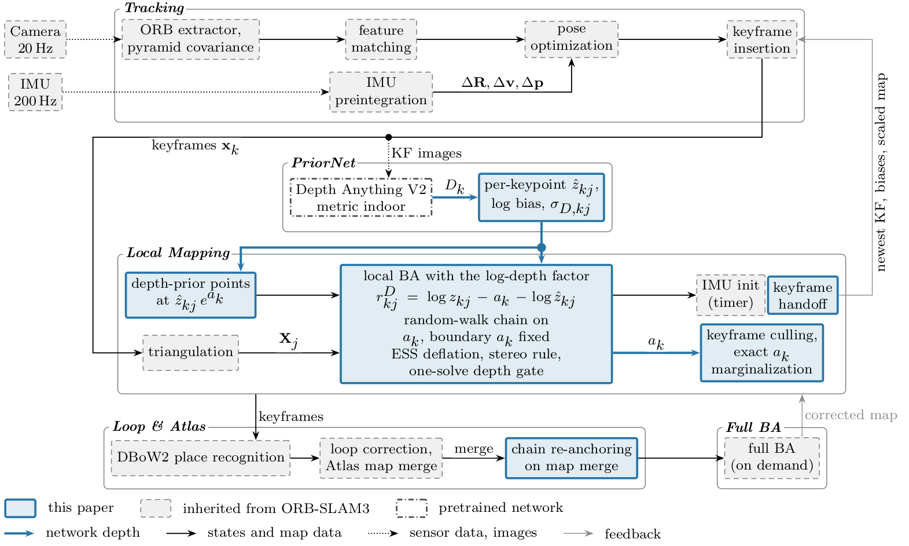
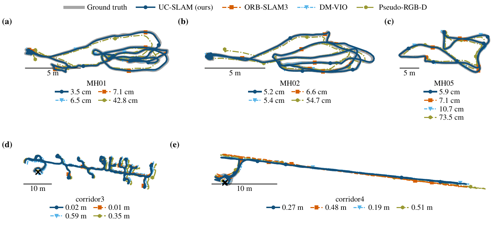

<div align="center">

# UC-SLAM

### Visual-Inertial SLAM with Learned Metric Depth Priors

Anonymous authors · *Paper under review*

[](LICENSE)




</div>

UC-SLAM is a keyframe visual-inertial SLAM system built on [ORB-SLAM3](https://github.com/UZ-SLAMLab/ORB_SLAM3). It fuses metric depth from a foundation depth network ([Depth Anything V2](https://github.com/DepthAnything/Depth-Anything-V2), metric indoor, ViT-B) into local bundle adjustment through a log-depth factor and a per-keyframe log-scale chain. Tracking runs on the CPU, and the depth network runs off the tracking path.

## Contents
1. [Highlights](#1-highlights)
2. [Installation](#2-installation)
3. [Data](#3-data)
4. [Run](#4-run)
5. [Configuration](#5-configuration)
6. [Results](#6-results)
7. [Code structure](#7-code-structure)
8. [Acknowledgements](#8-acknowledgements)
9. [Citation and license](#9-citation-and-license)

## 1. Highlights
- **Log-depth factor.** Each keypoint with a network depth gets a robust factor on the logarithm of its depth, with a noise model calibrated once per sensor domain from stereo reference depth (no ground-truth trajectory needed).
- **Per-keyframe log-scale chain.** A random walk over one log-scale per keyframe absorbs the scene-dependent bias of the network, and is marginalized exactly when a keyframe is culled.
- **ESS deflation.** Depth errors of one image are correlated, so their information is scaled down to an effective sample size.
- **Monocular-inertial robustness.** A cap on the early scale refinement of ORB-SLAM3 and a reset of a young map whose inertial scale disagrees with the depth prior.

## 2. Installation
Tested on Ubuntu 20.04 with g++ 9.4, CMake 3.16, OpenCV 4.2 and Eigen 3.3.7. Tracking needs only a CPU. The depth cache (Section 3) needs an NVIDIA GPU.

**System packages**
```bash
sudo apt install build-essential cmake git pkg-config curl \
    libeigen3-dev libopencv-dev libboost-serialization-dev libssl-dev \
    libgl1-mesa-dev libglew-dev libx11-dev libpng-dev libjpeg-dev
```

**Clone and build.** `build.sh` fetches the two submodules (ORB-SLAM3 at commit `4452a3c` for its vocabulary and timestamp files, Pangolin v0.6), builds Pangolin and then UC-SLAM.
```bash
git clone --recursive <repository-url> uc-slam && cd uc-slam
./build.sh                      # JOBS=<n> sets the parallel jobs
```
The binaries `mono_inertial_euroc`, `stereo_inertial_euroc` and `mono_inertial_tum_vi` are written to `cpp/ucslam/Examples/`. The fork compiles with `-march=native`, like ORB-SLAM3.

**Python environment** (depth cache, data and evaluation) with [uv](https://docs.astral.sh/uv/):
```bash
curl -LsSf https://astral.sh/uv/install.sh | sh
uv sync
```

## 3. Data
**Datasets.** [EuRoC MAV](https://doi.org/10.3929/ethz-b-000690084) and [TUM-VI](https://cvg.cit.tum.de/data/datasets/visual-inertial-dataset) (512 x 512). The script downloads, checks every archive against its recorded sha256 and extracts each sequence to `data/<dataset>/<sequence>/`, with the ground truth as `gt.tum`.
```bash
uv run python scripts/fetch_datasets.py --dataset euroc --sequences MH_01_easy --delete-archive
uv run python scripts/fetch_datasets.py --dataset tumvi --sequences room1 corridor1 --delete-archive
```

**Depth cache.** The network runs once per sequence and writes one metric depth map per frame to `data/depth/<dataset>/<sequence>/da2-metric-indoor-base/`. The weights are downloaded on first use (about 390 MB).
```bash
uv run python experiments/precompute_depth.py --seqs euroc/MH_01_easy tumvi/room1 tumvi/corridor1
```

## 4. Run
One run on EuRoC MH_01, monocular-inertial. The runner starts UC-SLAM, saves the keyframe and frame trajectories in TUM format, and scores them with [evo](https://github.com/MichaelGrupp/evo).
```bash
uv run python -m eval.run_orbslam3 --dataset euroc --mode mono_inertial --seqs MH_01_easy --runs 1 \
    --tree cpp/ucslam --settings configs/euroc_mono_inertial.yaml --tag demo
```
Outputs go to `runs/orbslam3/mono_inertial/MH_01_easy/demo/`: `run0.tum` (keyframes), `run0_frames.tum` (all frames), `run0.json` (scores) and `run0.log`.

Stereo-inertial EuRoC and TUM-VI (rooms are scored by ATE, corridor and magistrale sequences by end drift):
```bash
uv run python -m eval.run_orbslam3 --dataset euroc --mode stereo_inertial --seqs V1_01_easy --runs 1 \
    --tree cpp/ucslam --settings configs/euroc_stereo_inertial.yaml --tag demo
uv run python -m eval.run_orbslam3 --dataset tumvi --mode mono_inertial --seqs room1 corridor1 --runs 1 \
    --tree cpp/ucslam --settings configs/tumvi_mono_inertial.yaml --tag demo
```

Score a trajectory by hand:
```bash
uv run evo_ape tum data/euroc/MH_01_easy/gt.tum runs/orbslam3/mono_inertial/MH_01_easy/demo/run0.tum \
    --align --t_max_diff 0.02
```

> EuRoC monocular-inertial results depend on machine load, because the examples pace to the image timestamps and drop keyframes when local mapping is busy. Run one process at a time.

**ROS 1 and ROS 2.** [`ros/`](ros/) holds a SLAM node and a depth node for ROS 1 Noetic and ROS 2 Humble (with a Docker image), and notes for a Jetson Orin. The depth node runs the network on each new keyframe image, with the code of the depth cache. This support is new and not yet tested on a robot: see the test status in [ros/README.md](ros/README.md).

## 5. Configuration
Example settings are in [`configs/`](configs/):

| File | Sensor setup |
|---|---|
| `euroc_mono_inertial.yaml` | EuRoC, monocular-inertial |
| `euroc_stereo_inertial.yaml` | EuRoC, stereo-inertial |
| `tumvi_mono_inertial.yaml` | TUM-VI 512 x 512, monocular-inertial |
| `openloris_d435i_gaussian.yaml`, `openloris_d435i_tsinghua.yaml` | Intel RealSense D435i color camera + IMU (the two robots of OpenLORIS-Scene) |

Each file is an ORB-SLAM3 settings file plus a `UCSLAM.*` block. The main keys:
```yaml
UCSLAM.PriorNet: 1                         # read network depth for each keyframe
UCSLAM.DepthDir: "data/depth"              # depth cache, relative to the repository root
UCSLAM.DepthModel: "da2-metric-indoor-base"
UCSLAM.UseDepthFactor: 1                   # log-depth factor in local BA
UCSLAM.SigmaNetC0: 0.075                   # per-domain noise model of the network log-depth
UCSLAM.SigmaNetC1: 0.055
UCSLAM.LogBias: -0.015                     # per-domain log bias of the network
UCSLAM.NeffOverN: 0.008                    # ESS deflation ratio
UCSLAM.Sigma0: 0.1                         # trust radius of the scale anchor
UCSLAM.SigmaRW: 0.02                       # random-walk density of the log-scale chain [s^-1/2]
UCSLAM.MaxDepthPriorPoints: 100            # new map points from the depth prior per keyframe
UCSLAM.ScaleRefineMaxLog: 0.01             # cap on the early scale refinement (monocular-inertial)
UCSLAM.YoungMapScaleGate: 1.0              # young-map reset gate (monocular-inertial)
UCSLAM.YoungMapBiasGate: 0.0905
```
`UCSLAM.SigmaNetC0`, `SigmaNetC1`, `LogBias` and `NeffOverN` are fitted per sensor domain. A new camera needs its own values from reference depth. Their provenance for EuRoC and TUM-VI is `experiments/out/depth_prior_bench.json`. All constants are also listed in `configs/default.yaml`.

## 6. Results
Monocular-inertial (10 runs per sequence, 3 on the long TUM-VI sequences, mean over the sequences of the per-sequence means). Lower is better.

| Dataset | Metric | UC-SLAM |
|---|---|---|
| EuRoC, 11 sequences | keyframe ATE, SE(3) | 4.69 cm |
| EuRoC, 11 sequences, stereo-inertial | keyframe ATE, SE(3) | 3.26 cm |
| TUM-VI rooms, 6 sequences | keyframe ATE, SE(3) | 0.71 cm |
| TUM-VI corridors, 5 sequences | end drift | 0.086 % of the path |
| TUM-VI magistrale, 6 sequences | end drift | 0.479 % of the path |

[`results/`](results/) holds the per-run score files and one estimated trajectory per sequence (the median run).

<div align="center">

</div>

**Limitations.** The covariance that UC-SLAM reports is over-confident and should not feed downstream decisions without recalibration. The depth prior inherits the failure modes of zero-shot depth networks (sky, water, transparent surfaces, scenes far from the training data). UC-SLAM keeps the initializer of ORB-SLAM3, which often fails on slow ground robots. Only indoor sequences were tested.

## 7. Code structure
```
cpp/ucslam/        UC-SLAM, a modified ORB-SLAM3 (changes listed in cpp/ucslam/MODIFICATIONS.md)
  src/PriorNet.cc      depth thread: reads the depth cache and builds per-keypoint depth measurements
  src/UcslamTypes.cc   log-depth factor, log-scale vertex and chain edges (g2o)
  src/Optimizer.cc     local BA with the depth factors, the chain and its exact marginalization
  src/LocalMapping.cc  depth-prior points, scale cap, young-map gate
configs/             example settings and default.yaml (every constant)
ucslam/              camera models, depth network wrapper, geometry, trajectories
experiments/         depth cache (precompute_depth.py) and the depth-constant provenance
eval/                runner and scorer (run_orbslam3.py)
ros/                 ROS 1 and ROS 2 nodes with live depth, Docker image for ROS 2
scripts/             build and dataset scripts
results/             score files and trajectories
third_party/         ORB_SLAM3 and Pangolin (git submodules)
```

## 8. Acknowledgements
UC-SLAM builds on [ORB-SLAM3](https://github.com/UZ-SLAMLab/ORB_SLAM3) and its libraries [DBoW2](https://github.com/dorian3d/DBoW2), [g2o](https://github.com/RainerKuemmerle/g2o) and [Sophus](https://github.com/strasdat/Sophus). It uses [Depth Anything V2](https://github.com/DepthAnything/Depth-Anything-V2), [Pangolin](https://github.com/stevenlovegrove/Pangolin) and [evo](https://github.com/MichaelGrupp/evo), and is evaluated on [EuRoC MAV](https://doi.org/10.3929/ethz-b-000690084) and [TUM-VI](https://cvg.cit.tum.de/data/datasets/visual-inertial-dataset). We thank the authors. See [THIRD_PARTY_NOTICES.md](THIRD_PARTY_NOTICES.md).

## 9. Citation and license
The paper is under review. A BibTeX entry will be added after the review.

UC-SLAM is released under the [GNU General Public License v3](LICENSE) or later, like ORB-SLAM3, of which `cpp/ucslam` is a modified version. Third-party components keep their own licenses (see [THIRD_PARTY_NOTICES.md](THIRD_PARTY_NOTICES.md)). The depth network weights are not distributed here and remain under their own license.
